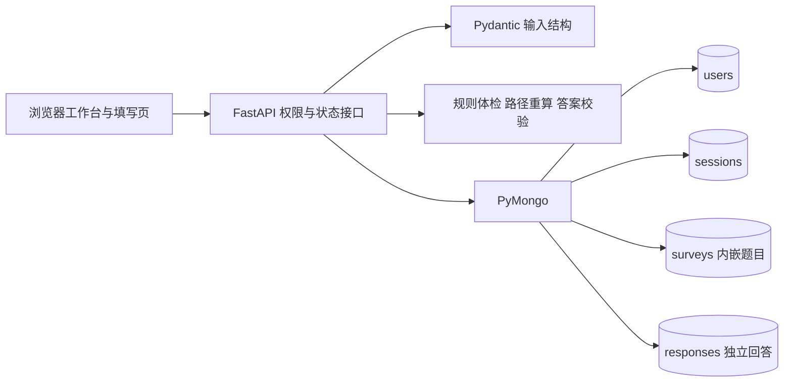

# 基于 MongoDB 的问卷系统第一阶段项目完成报告

项目名称：问序 SurveyFlow  
课程：当代数据管理系统  
阶段：大作业一 第一阶段  
日期：2026年10月22日  
姓名：葛一凡  
学号：10245501445

## 一 项目目标与完成结论

本项目使用Python FastAPI与PyMongo开发在线问卷系统，以MongoDB存储全部业务数据，实现注册登录、作者管理问卷、发布链接、逐题填写、条件跳转、输入校验、回答保存与实时统计。第一阶段功能已实现，并在用户Windows与Conda dm_project1环境通过73项自动化测试；浏览器已完成创建发布、两条不同路径填写及统计验收。

实现重点围绕数据库设计、后端逻辑、文档和可追溯AI使用过程展开。除基础需求外，增加发布前规则自动体检、服务端路径重算、可解释答题轨迹、并发防重与请求幂等、发布冻结、草稿乐观锁和第一阶段快照。这些设计对应明确业务风险，能够通过程序行为和测试展示，而不只停留在报告概念。

第二阶段需求变更只用于分析未来结构演化；题目库、共享题、历史题目版本、恢复与跨问卷题目统计尚未实现，也未计入本阶段完成情况。

## 二 需求分析与技术路线

依据本机保存的《大作业一第一阶段》和《大作业一 需求变更》两份文档核对需求。原始文档副本与来源校验信息位于requirements目录。第一阶段文档要求所有数据存储在MongoDB、不得使用关系数据库或现成问卷框架，强调条件逻辑可配置、测试用例与真实AI日志。

一个需要明确的需求交叉是“允许匿名填写”与“填写者需要先登录”。本项目将匿名解释为对问卷作者匿名，而非未登录访问：填写API必须鉴权，匿名回答不保存公开user_id，内部散列只用于账号去重。这使登录、匿名与每人一次可以同时成立。

采用FastAPI定义接口与自动API规范，Pydantic约束输入结构，PyMongo直接操作MongoDB；前端为原生HTML/CSS/JavaScript，无构建依赖。通过同源Cookie维持登录，在本机127.0.0.1提供网页与API。界面包含问卷工作台、可视化设计室、逐题填写、核对路径、统计与作者回答记录。

## 三 系统结构

`app/models.py`负责接口数据形状，`engine.py`是可独立测试的纯业务引擎，`database.py`负责连接、BSON校验器和索引，`main.py`组织鉴权、状态与存储。前端仅收集交互，不作为最终校验依据。测试分为规则单元测试和真实MongoDB接口集成测试。

注册用户可以创建和查看自己的问卷；其他用户只能在登录后填写已发布链接。权限在每个管理接口的owner_id条件中强制执行，不能通过猜测ID读取别人的统计或关闭问卷。

## 四 MongoDB设计与理由

采用users、sessions、surveys、responses四集合。users保存账号和密码派生散列；sessions保存随机会话凭证的散列与到期时间；surveys保存问卷元数据、状态、结构版本、修订号及有界题目数组；responses保存每次提交的答案、路径与规则轨迹。

问卷和题目在第一阶段共同创建、共同读取，题目定义有上限，适合嵌入。回答会持续增长，应单独存文档并引用问卷，避免单个survey无限变大和多人写入争抢同一回答数组。可变题型的校验和规则自然表现为嵌套文档，不需要将所有选项与规则拆成关系式连接表。MongoDB灵活性配合应用校验与BSON核心类型校验使用，而不是允许任意脏数据。

每份问卷有schema_version=1和revision。revision标记草稿修订，保存时用条件更新实现乐观锁；发布后定义冻结，每份response保存survey_revision，保证答案与定义可对应。题目ID在本问卷内唯一，不承诺跨问卷共享语义，为第二阶段保留清晰迁移起点。

索引围绕访问路径设计：用户名唯一、会话token唯一与TTL、作者+创建时间、状态+截止时间、问卷+提交时间、请求幂等复合唯一索引、仅对单次填写回答生效的partial unique索引。索引与BSON校验器由程序启动自动建立；完整字段、样例和取舍见database-design.md与schema/mongodb-schema.json。

## 五 跳转与校验设计

每道题的rules数组保存操作符、比较值与目标，支持单选eq、多选contains/contains_all、数字eq/gt/gte/lt/lte/between。数组从上到下判断，第一条命中即跳转；未命中则顺序下一题；END表示结束。跳转只能向后，发布体检阻止不存在目标、回跳和循环。文本题不支持条件跳转，符合本阶段要求。

预览与提交共用walk函数。提交时服务器从首题重算访问路径，检查到达题目的输入；被跳过的必答题无需回答，但提交隐藏题答案会拒绝，避免伪造数据影响统计。path记录访问题目，trace记录命中规则，便于解释路径与复核。返回上一题会清除之后路径，防止旧分支残留。

校验分三层：接口模型约束类型与字段，发布体检检查跨字段和规则语义，实际回答校验输入内容。单选必须为合法选项；多选不得重复并满足数量；文本满足长度且必答不能纯空白；数字必须为有限数值、满足整数与范围条件，拒绝布尔和数字字符串。数值绝对值限定在9007199254740991以内，避免浏览器精度和BSON整数边界不一致。

## 六 生命周期与一致性

状态机为draft→published→closed。发布后不可修改题目、规则与开关；截止时间到达时即使数据库status仍为published，服务器也拒绝下一题与提交。日期必须带时区，UTC比较与存储，网页按本地时间输入展示。

重复提交有两种不同语义：同一次提交的网络重试沿用request_id，返回已保存回答；新的填写使用新request_id。若问卷禁止同账号多次填写，数据库partial unique索引保证并发情况下也只能保存一份；允许多次时每份独立保存。

提交与关闭通过同一survey的原子准入更新明确先后，不依赖仅进程内有效的锁。本机单节点不使用多文档事务；准入后崩溃可能使submission_seq增加而无回答，所以真实总数始终从responses计算。已准入请求可在关闭后完成插入，这是明确的一致性边界，并非宣称跨文档强事务。

## 七 统计设计

作者可查看整卷和单题统计。单选按答案分组计数，多选先展开数组后分组，数字使用MongoDB的avg/min/max聚合，文本与数字原始内容分页展示。没有回答的选项返回0，没有数字回答返回null。跳过和空选答题不计入该题回答人数；多选选项次数之和可超过人数。

不保存持久化统计汇总，避免提交与汇总更新之间的不一致。分页影响原始填空内容显示，不改变均值或总数。对本阶段规模，按survey_id过滤后的实时聚合便于解释与验证；没有声称已完成大规模性能调优。

## 八 创新与可验证证据

| 亮点 | 解决的问题 | 证据 |
|---|---|---|
| 发布前规则自动体检 | 配置错误上线后才暴露 | 无效目标、回跳、约束冲突等测试；设计室体检提示 |
| 服务端路径重算 | 客户端伪造隐藏答案或绕过必答 | 跳过题答案提交返回422，统计不被污染 |
| 可解释路径与轨迹 | 跳转原因不透明 | 核对页路径、responses.trace、真实截图 |
| 并发唯一约束与幂等 | 连点、重试或并发产生重复数据 | 6并发单次仅1份；6同键重试同ID；12并发多次保存12份 |
| 草稿乐观锁与发布冻结 | 多页面覆盖或发布后改变统计语义 | 旧revision409；发布后编辑409 |
| 第一阶段可核验快照 | 第二阶段修改后无法说明原设计 | 基线ZIP、逐文件SHA-256、校验脚本 |

这些是设计亮点，不是对评分的保证。规则体检未做完整符号可达性证明；匿名不抵抗数据库管理员重识别；快照哈希用于内容一致性，不是数字签名或可信时间戳。

## 九 测试过程与真实结果

第一轮实际54项自动测试通过，随后补充边界与并发场景，最终记录为73 passed, 1 warning in 6.13s。原始输出和JUnit逐用例结果已保留。测试连接真实MongoDB，在随机测试库中执行后仅清除该测试库，不清空正式库。参数化输入按独立用例计数。

覆盖创建问卷、添加题目、单选/多选/数字跳转、文本数字数量校验、最终提交、统计、权限、截止关闭、匿名、会话过期、数据库校验器、并发单次、多次与幂等重试。详细步骤、输入、预期与实测见testing.md。

浏览器实际验收使用本地演示账号，创建四题型问卷并发布。路径一是q1→q3→END，路径二是q1→q2→q4；路径二输入8.5触发整数错误，改8后成功。统计页显示2份提交，数字题均值8，文本建议与匿名记录均正确。截图和演示数据属于测试数据，不代表真实问卷调研结果。

## 十 遇到的问题与解决

第一版编辑器保存使用范围过宽的data-q选择器，误把规则删除按钮当作题目节点，网页体检触发读取null。AI通过真实浏览器发现，收窄为question-card选择器，刷新后重新完成保存、体检、发布和填写。这说明仅验证API不足以保证用户流程可用。

Python允许非常大的整数，但JavaScript整数精度与BSON整数范围有限。自查后给数字输入、规则值和数值约束统一加入安全范围，并增加超大整数测试。密码与会话数据也采用派生散列，而不是将演示阶段的简便做法变成明文存储。

单节点MongoDB不能假定已配置事务环境，因此采用不可变问卷定义、单文档原子准入与唯一索引，并明确崩溃情况下的统计口径。未用未经验证的事务调用掩盖一致性限制。

## 十一 AI使用与贡献边界

本次主要由Codex协助设计、生成程序、编写和执行测试、操作浏览器、修复问题并撰写文档。用户决定B方向与第一阶段范围、提供需求和环境、验证依赖与MongoDB，并参与查看页面和追问设计。完整真实记录见ai-log.md。

AI确实写出过前端错误，并通过实际执行修复；报告不将这些修复说成学生独立完成。此前聊天部分助手文本无法恢复，日志不虚构其内容。学生提交前应亲自运行验收、理解数据库与规则设计，核对本人信息，并仅补充本人真实发生的审阅或修改。

## 十二 第二阶段演化与保留

未来可新增不可变题目版本、共享授权和题库集合，在现有内嵌题目上增加可选来源版本引用；继续保留发布快照、问卷本地题号、现有回答与规则引擎。旧问卷无来源元数据也应继续运行。跨卷统计先按准确题目版本汇总，不能仅靠标题相同就合并。

本阶段仅给出演化设计，不创建这些新功能。归档快照与逐文件清单保留第一阶段原貌，后续按迁移计划增量修改并重跑回归测试，满足不得推倒重做的约束。

## 十三 交付与限制

交付包含后端与网页源码、依赖和启动说明、可执行MongoDB schema/索引、API规范、数据库与关键逻辑文档、自动测试及原始结果、浏览器截图、AI日志、项目报告和第一阶段基线。README提供Windows、Anaconda Prompt和Spyder使用步骤。

当前定位为本地课程系统，尚未实现账号找回、生产级登录限流、公网HTTPS部署、未提交草稿恢复、大规模压测和故障恢复演练。规则只向前，改变前置答案需重新填写后续路径。对这些限制如实说明，避免把未实现内容写成完成项。

## 十四 E盘本地安装与8001端口复验

2026年10月22日22时50分至22时53分（北京时间），用户将解压项目移至 E:\当代数据管理系统\大作业\dm_project1，激活Conda dm_project1，启动服务器。因8000端口已有演示服务占用，改用8001端口后成功打开网页。用户确认“能打开”，随后明确委托AI助手执行测试，并提供姓名葛一凡、学号10245501445用于报告署名。

AI助手直接在E盘这份代码目录重新执行全部自动化用例，输出保存到本交付包的docs/test-run-E-drive.txt和test-results-E-drive.xml，真实结果为73 passed, 1 warning in 5.98s。该结果是重新执行所得，不是将原有结果复制为本地验收结果；测试使用独立随机MongoDB测试库。

AI助手同时在用户启动的 http://127.0.0.1:8001 上完成真实浏览器复验，使用既有演示账号创建独立测试问卷“第一阶段本地验收 8001”，执行保存、规则体检、发布。第一份回答走q1→q3→结束；第二份回答先用8.5触发整数错误，改为8后走q1→q2→q4并提交。统计显示2份回答，数字题1人作答、均值8，多选开放时间1次，文本建议可见，两份记录均显示匿名。

最后关闭本次新建测试问卷，重新进入分享链接，页面明确显示已关闭或已截止。原先“校园学习体验调研”演示问卷未关闭。本次没有更改用户业务问卷或程序代码。新增截图为local-8001-statistics.png与local-8001-closed.png。

本次操作与结果由AI助手执行，用户完成本地解压、目录调整、启动及访问确认；不将代理执行写成学生独立手工测试。原始第一阶段基线ZIP与SHA-256清单保持不变；当前署名报告和新增复验材料是提交阶段补充，因此相对于旧基线会有文档差异，核心源码未改变。
